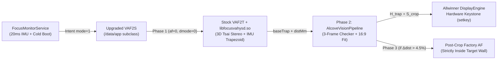

# WZATCO Yuva Blaze — Complete Reverse-Engineering & Manual Customization Guide (macOS Edition)

This guide is the **macOS (`zsh` / Apple Silicon & Intel Mac)** counterpart to the Windows engineering manual. It covers **everything we reverse-engineered, built, debugged, and deployed** on your **WZATCO Yuva Blaze** projector using native macOS tools (`adb`, `arp`, `tcpdump`, `javac`/`d8`/`apksigner`, `python3` + Pillow, `shasum`, and Preview).

---

## 1. Hardware & Firmware Architecture

| Subsystem | Hardware / Binary Details |
|---|---|
| **SoC & OS** | Allwinner H727 (`sun50iw15p1`), 4× ARM Cortex-A53 (`armeabi-v7a` 32-bit only), 1 GB RAM, Android 14 `userdebug` (`A series_0.0.1_2604240125`), SELinux `Permissive` |
| **Optical Panel** | BOE `1920×1080` native LCD (`castmode` + Allwinner DisplayEngine hardware keystone) |
| **Signing Key** | Standard AOSP `platform` testkey (`SHA-256: c8a2e9bccf597c2fb6dc66bee293fc13f2fc47ec77bc6b2b0d52c11f51192ab8`) |
| **Verified Boot (AVB)** | `vbmeta_a` hashes `boot`, `dtbo`, `init_boot`, `vendor_boot`, `product`, `system`, and `vendor`. **`bootloader_a`, `Reserve0_a`, and `/data` are outside AVB** — allowing 100% safe `/data/app` upgrades and boot-splash updates without touching `/system` or `/vendor`. |
| **Internal Camera** | USB UVC `640×480` YUYV422 camera at `/dev/video0` (`config.disable_cameraservice=true` disables Android Camera2; accessed directly via V4L2 JNI methods `HYSDVAF2.s0cam(0,2)`, `s1cam(byte[614400])`, `s2cam()` in `libfocusvahysd.so`). |
| **Factory Calibration** | Per-unit Tsai camera-projector stereo extrinsics & lookup tables stored in `/sdcard/focus/` (`camdata`, `hybin`, `hybin2`, `usefuldata`) and `/Reserve0/focus/`. |
| **Hardware Keystone** | `com.hysd.client.VAFclientapi` (`HYSDInterface.setkey(ltx, lty, lbx, lby, rbx, rby, rtx, rty)`) passes 8 inward pixel offsets to Allwinner `IDisplayConfig`: `TL=(ltx, lty)`, `BL=(lbx, 1080-lby)`, `BR=(1920-rbx, 1080-rby)`, `TR=(1920-rtx, lty)`. |
| **Repoint & Boot Monitor** | `com.htp.app.jetter.service.FocusMonitorService` polls the 3-axis IMU every `20 ms` (`DataDriftChecker`) and triggers `com.hysd.hyscreen/.VAF2S` (`mode=1, afswitch=1, keyswitch=1, dmode=3`) on bootup and whenever the projector settles after moving. |



---

## 2. macOS Prerequisites & Toolchain Setup

Open **Terminal** (`zsh`) and install the Android command-line tools, JDK 17, and Pillow:

```zsh
# 1. Install ADB, JDK 17, and Python Pillow via Homebrew
brew install --cask android-platform-tools temurin@17
brew install python
python3 -m pip install --upgrade pillow

# 2. Install Android SDK build-tools & platform 34 (skip if Android Studio is already installed)
brew install --cask android-commandlinetools
export ANDROID_HOME="$HOME/Library/Android/sdk"
mkdir -p "$ANDROID_HOME"
yes | sdkmanager --sdk_root="$ANDROID_HOME" "platforms;android-34" "build-tools;34.0.0"

# 3. Export helper paths for this shell session (add to ~/.zshrc if desired)
export JAVA_HOME="$(/usr/libexec/java_home -v 17)"
export ANDROID_SDK="${ANDROID_HOME:-$HOME/Library/Android/sdk}"
export BT_DIR="$(ls -d "$ANDROID_SDK"/build-tools/* | sort -V | tail -n 1)"
export PLAT_JAR="$(ls "$ANDROID_SDK"/platforms/*/android.jar | sort -V | tail -n 1)"
export PATH="$JAVA_HOME/bin:$BT_DIR:$PATH"
```

---

## 3. Connecting Over Wi-Fi, Network Capture & Full Factory Backup on macOS

### 3.1 Finding the Projector on macOS (Same Wi-Fi or Mac Internet Sharing)
Your projector listens on wireless ADB port `5555` (`MAC: 3c:be:8e:43:78:87`).
> **macOS `arp` quirk**: BSD `arp -an` on macOS strips leading zeroes from hex bytes (e.g., `08` prints as `8`), so match flexibly:

```zsh
# Option A: If on the same Wi-Fi router, warm the ARP cache with a quick broadcast ping first:
ping -c 2 255.255.255.255 >/dev/null 2>&1 || true

# Locate projector IP from macOS ARP table:
PROJ_IP="$(arp -an | grep -Ei '3c:be:8e:43:78:87' | sed -E 's/.*\(([0-9.]+)\).*/\1/' | head -n 1)"
echo "Projector IP: $PROJ_IP"

adb connect "${PROJ_IP}:5555"
adb -s "${PROJ_IP}:5555" devices
```

#### Bonus: Capturing Outbound Projector Telemetry on macOS
Unlike Windows (where Defender `SenseNdr` locks `pktmon`), macOS makes full packet capture effortless if you share Internet from USB/Ethernet over Wi-Fi (**System Settings → General → Sharing → Internet Sharing** creates `bridge100` on `192.168.2.1`):

```zsh
# Capture all projector DNS, TLS SNI, and HTTP/HTTPS endpoints directly on bridge100:
sudo tcpdump -i bridge100 -nn -v -w ~/Desktop/projector_traffic.pcap
# Press Ctrl+C when done, then inspect DNS queries:
tcpdump -nn -r ~/Desktop/projector_traffic.pcap 'udp port 53'
```

### 3.2 Full eMMC Partition & Optical Calibration Backup on macOS
Because `/dev/block/mmcblk0` has `0666` (`rw-rw-rw-`) permissions on this firmware, you can pull bit-for-bit partition images over ADB and verify SHA-256 hashes with macOS `shasum -a 256`:

```zsh
BACKUP_DIR="$HOME/Backups/Wzatco-Yuva-Blaze"
mkdir -p "$BACKUP_DIR/calibration" "$BACKUP_DIR/partitions"

# 1. Back up unit-unique factory Tsai camera/projector calibration (CRITICAL!)
adb -s "${PROJ_IP}:5555" pull /sdcard/focus "$BACKUP_DIR/calibration/focus"
adb -s "${PROJ_IP}:5555" pull /sdcard/focus_d "$BACKUP_DIR/calibration/focus_d"

# 2. Dump raw partitions by GPT LBA (example: bootloader_a at LBA 106496, 65536 sectors = 32 MiB)
adb -s "${PROJ_IP}:5555" exec-out "dd if=/dev/block/mmcblk0 bs=512 skip=106496 count=65536 2>/dev/null" \
  > "$BACKUP_DIR/partitions/bootloader_a.img"

# 3. Dump Reserve0_a (LBA 7422976, 32768 sectors = 16 MiB) and factorydata (LBA 73728, 32768 sectors)
adb -s "${PROJ_IP}:5555" exec-out "dd if=/dev/block/mmcblk0 bs=512 skip=7422976 count=32768 2>/dev/null" \
  > "$BACKUP_DIR/partitions/Reserve0_a.img"
adb -s "${PROJ_IP}:5555" exec-out "dd if=/dev/block/mmcblk0 bs=512 skip=73728 count=32768 2>/dev/null" \
  > "$BACKUP_DIR/partitions/factorydata.img"

# 4. Verify SHA-256 bit-for-bit on macOS vs live eMMC
MAC_SHA="$(shasum -a 256 "$BACKUP_DIR/partitions/bootloader_a.img" | awk '{print $1}')"
DEV_SHA="$(adb -s "${PROJ_IP}:5555" shell "dd if=/dev/block/mmcblk0 bs=512 skip=106496 count=65536 2>/dev/null | sha256sum" | awk '{print $1}')"
echo "Mac=$MAC_SHA  Device=$DEV_SHA"
[[ "$MAC_SHA" == "$DEV_SHA" ]] && echo "SHA-256 MATCH VERIFIED!" || echo "MISMATCH!"
```

---

## 4. Building, Debugging & Tuning the 3-Phase Alignment Engine on macOS

### 4.1 Architecture Recap
1. **Phase 1 — Fast 3D Trapezoid (`~2.7 s`)**: Runs stock `VAF2T` with `afswitch=0, dmode=0` to solve the full 3D perspective trapezoid `baseTrap` + stereo throw distance `result_angle[9]` (mm), without wasting time motor-hunting on uncropped side walls.
2. **Phase 2 — Constant-Flux Checkerboard Alcove Fit (`~0.78 s`)**: Projects 3 constant-50%-flux `20×12` checkerboards (`MODE_CHECKER_POS`, `MODE_CHECKER_NEG`, `MODE_ORIGIN_TAG`) *inside* `baseTrap`, gates V4L2 frames closed-loop on signed pixel inversion, runs $O(1)$ van Herk max-filters + `209`-corner RANSAC homography + monotonic-stack `16:9` fit, and composes $\mathbf{H}_{\text{trap}} \circ \mathbf{S}_{\text{crop}}$ so all 4 corners on the wall stay exact $90^\circ$ right angles.
3. **Phase 3 — Smart Distance-Gated Post-Crop Autofocus (`0 s` on pan/tilt, `~5 s` on cold boot / new throw distance)**: Stops Phase 1's `motorbegin` thread (`motorthreadstop(-3)`), checks if throw distance changed `> 4.5%`, and if so focuses *strictly inside* the cropped `16:9` target wall.

### 4.2 Rebuilding & Deploying `com.hysd.screen-turbo-alcove.apk` on macOS
> **macOS vs Windows note**: Java classpaths on macOS use a colon (`:`) separator (`-cp "$STUBS_JAR:$PLAT_JAR"`), and `zip` on macOS must be run with `-X` (no extra Finder/UID attributes).

```zsh
set -euo pipefail

REPO_PROJ="$PWD/Projector"   # Path to the Projector folder cloned from NuthanReddy/FutureTech
WORK_DIR="$(mktemp -d /tmp/alcove_build.XXXXXX)"
mkdir -p "$WORK_DIR/stubs_classes" "$WORK_DIR/app_classes" "$WORK_DIR/dex_out"

# 1. Compile stubs (SystemProperties, HYSDInterface, VAF2T, HYSDVAF2)
javac --release 8 -cp "$PLAT_JAR" \
  -d "$WORK_DIR/stubs_classes" \
  $(find "$REPO_PROJ/alcove_upgrade/stubs" -name '*.java')
jar cf "$WORK_DIR/stubs.jar" -C "$WORK_DIR/stubs_classes" .

# 2. Compile upgraded VAF2S + AlcoveVisionPipeline + HomographySolver + PatternOverlayView
javac --release 8 -cp "$WORK_DIR/stubs.jar:$PLAT_JAR" \
  -d "$WORK_DIR/app_classes" \
  $(find "$REPO_PROJ/alcove_upgrade/src" -name '*.java')
jar cf "$WORK_DIR/alcove_engine.jar" -C "$WORK_DIR/app_classes" .

# 3. Compile bytecode to classes3.dex via d8
"$BT_DIR/d8" --min-api 26 --lib "$PLAT_JAR" \
  --classpath "$WORK_DIR/stubs.jar" \
  --output "$WORK_DIR/dex_out" \
  "$WORK_DIR/alcove_engine.jar"

# 4. Patch stock classes.dex (Lcom/hysd/hyscreen/VAF2S; -> Lcom/hysd/hyscreen/VAF2T;) with SHA-1 + Adler32
cp "$REPO_PROJ/projector_artifacts/com.hysd.screen.apk" "$WORK_DIR/unsigned.apk"
unzip -p "$WORK_DIR/unsigned.apk" classes.dex > "$WORK_DIR/classes.dex"

python3 - "$WORK_DIR/classes.dex" <<'PY'
import hashlib, struct, sys, zlib
p = sys.argv[1]
data = bytearray(open(p, "rb").read())
old, new = b"Lcom/hysd/hyscreen/VAF2S;", b"Lcom/hysd/hyscreen/VAF2T;"
cnt = data.count(old)
assert cnt > 0, "VAF2S descriptor not found"
data = data.replace(old, new)
data[12:32] = hashlib.sha1(data[32:]).digest()
struct.pack_into("<I", data, 8, zlib.adler32(data[12:]) & 0xFFFFFFFF)
open(p, "wb").write(data)
print(f"Patched {cnt} occurrences in classes.dex")
PY

cp "$WORK_DIR/dex_out/classes.dex" "$WORK_DIR/classes3.dex"
zip -d "$WORK_DIR/unsigned.apk" classes.dex "classes3.dex" 2>/dev/null || true
(cd "$WORK_DIR" && zip -0 -X unsigned.apk classes.dex && zip -9 -X unsigned.apk classes3.dex)

# 5. Zipalign (4-byte page-aligned) & sign with AOSP platform key
"$BT_DIR/zipalign" -p -f 4 "$WORK_DIR/unsigned.apk" "$WORK_DIR/aligned.apk"
"$BT_DIR/apksigner" sign \
  --key "$REPO_PROJ/alcove_upgrade/keys/platform.pk8" \
  --cert "$REPO_PROJ/alcove_upgrade/keys/platform.x509.pem" \
  --out "$WORK_DIR/com.hysd.screen-turbo-alcove.apk" \
  "$WORK_DIR/aligned.apk"

# 6. Install to /data/app & AOT-compile for maximum Cortex-A53 speed
adb -s "${PROJ_IP}:5555" install -r -d "$WORK_DIR/com.hysd.screen-turbo-alcove.apk"
adb -s "${PROJ_IP}:5555" shell "cmd package compile -m speed -f com.hysd.hyscreen"
echo "Deployed and AOT-compiled successfully!"
```

### 4.3 Live Debugging & Visual Inspection on macOS
```zsh
# Stream real-time alignment, corner count, seam scores, and motor timing in Terminal:
adb -s "${PROJ_IP}:5555" logcat -v time -s TurboAlcoveVAF2S:V TurboAlcove:V hysdFocus:V FocusMonitorService:V

# Run a single diagnostic pass and immediately pop open the 1280x480 debug map in macOS Preview:
adb -s "${PROJ_IP}:5555" shell "setprop persist.hysd.alcove.debug 1 && rm -f /sdcard/alcove_debug.png"
adb -s "${PROJ_IP}:5555" shell "am startservice -n com.hysd.hyscreen/.VAF2S --ei mode 1 --ei afswitch 1 --ei keyswitch 1 --ei dmode 3"
sleep 6
adb -s "${PROJ_IP}:5555" shell "setprop persist.hysd.alcove.debug 0"
adb -s "${PROJ_IP}:5555" pull /sdcard/alcove_debug.png /tmp/alcove_debug.png && open /tmp/alcove_debug.png

# Instant toggle back to stock alignment (1 = stock, 0 = turbo):
adb -s "${PROJ_IP}:5555" shell "setprop persist.hysd.turbo_disable 0"

# Full uninstall rollback to untouched /system APK:
adb -s "${PROJ_IP}:5555" uninstall com.hysd.hyscreen
```

---

## 5. Changing the Boot Screen from macOS (Power-On Splash + Android Boot Stage)

> **macOS Pitfall Avoided**: Never create `bootanimation.zip` using macOS Finder's *"Compress"* menu—Finder uses Deflate compression and injects `__MACOSX/` resource forks and `.DS_Store`, causing `/system/bin/bootanimation` to reject the archive (`bootanimation.zip is compressed; must be only stored`). The Python script below generates both a pure `ZIP_STORED` archive and the exact `6,220,854`-byte bottom-up 24-bit BGR `BOOTLOGO.BMP`.

```zsh
set -euo pipefail

PHOTO_PATH="$HOME/Pictures/my_boot_photo.jpg"
CROP_TOP_Y=850   # Vertical offset in source pixels for 16:9 crop (adjust for framing)
OUT_DIR="$(mktemp -d /tmp/proj_boot.XXXXXX)"

# 1. Generate 1920x1080 JPEG, pure STORE bootanimation.zip, and exact 6,220,854-byte 24-bit BGR BOOTLOGO.BMP
python3 - "$PHOTO_PATH" "$CROP_TOP_Y" "$OUT_DIR" <<'PY'
import os, sys, zipfile
from PIL import Image, ImageOps

src_path, crop_top_y, out_dir = sys.argv[1], int(sys.argv[2]), sys.argv[3]
im = ImageOps.exif_transpose(Image.open(src_path)).convert("RGB")
w, h = im.size
crop_h = round(w * 9 / 16)
top = max(0, min(crop_top_y, h - crop_h))
framed = im.crop((0, top, w, top + crop_h)).resize((1920, 1080), Image.Resampling.LANCZOS)

jpg_path = os.path.join(out_dir, "01.jpg")
framed.save(jpg_path, "JPEG", quality=95, subsampling=0)

# Build pure ZIP_STORED bootanimation.zip (zero __MACOSX / .DS_Store)
zip_path = os.path.join(out_dir, "bootanimation.zip")
with zipfile.ZipFile(zip_path, "w", compression=zipfile.ZIP_STORED) as zf:
    zf.writestr("desc.txt", b"1920 1080 15\np 0 0 part0\n")
    zf.write(jpg_path, "part0/01.jpg")

# Build exact 6,220,854-byte uncompressed 24-bit bottom-up BGR BMP matching stock header bit-for-bit
hdr = bytes.fromhex(
    "424d36ec5e00000000003600000028000000800700003804000001001800"
    "0000000000ec5e00c40e0000c40e00000000000000000000"
)
rgb = framed.tobytes()
bmp = bytearray(6220854)
bmp[:54] = hdr
stride = 1920 * 3
for y in range(1080):
    src_off = (1079 - y) * stride
    dst_off = 54 + y * stride
    row_rgb = rgb[src_off : src_off + stride]
    # RGB -> BGR
    bmp[dst_off + 0 : dst_off + stride : 3] = row_rgb[2::3]
    bmp[dst_off + 1 : dst_off + stride : 3] = row_rgb[1::3]
    bmp[dst_off + 2 : dst_off + stride : 3] = row_rgb[0::3]

bmp_path = os.path.join(out_dir, "custom_bootlogo.bmp")
open(bmp_path, "wb").write(bmp)
print("Generated:", bmp_path, len(bmp), "bytes &", zip_path)
PY

# Preview the exact 16:9 crop on your Mac before flashing:
open "$OUT_DIR/01.jpg"

# 2. Push, splice preserving the 458 trailing bytes of LBA 138983, write, and verify SHA-256!
BMP_SHA="$(shasum -a 256 "$OUT_DIR/custom_bootlogo.bmp" | awk '{print $1}')"
ZIP_SHA="$(shasum -a 256 "$OUT_DIR/bootanimation.zip" | awk '{print $1}')"

adb -s "${PROJ_IP}:5555" push "$OUT_DIR/bootanimation.zip" "/data/local/tmp/bootanimation.zip"
adb -s "${PROJ_IP}:5555" push "$OUT_DIR/custom_bootlogo.bmp" "/data/local/tmp/custom_bootlogo.bmp"

adb -s "${PROJ_IP}:5555" shell '
cat /data/local/tmp/bootanimation.zip > /Reserve0/bootanimation.zip &&
dd if=/dev/block/mmcblk0 of=/data/local/tmp/bl_tail.bin bs=512 skip=138983 count=1 2>/dev/null &&
cat /data/local/tmp/custom_bootlogo.bmp > /data/local/tmp/custom_bootlogo_padded.bmp &&
dd if=/data/local/tmp/bl_tail.bin bs=1 skip=54 count=458 2>/dev/null >> /data/local/tmp/custom_bootlogo_padded.bmp &&
dd if=/data/local/tmp/custom_bootlogo_padded.bmp of=/dev/block/mmcblk0 bs=512 seek=126833 count=12151 conv=notrunc,fsync &&
sync &&
rm -f /data/local/tmp/bootanimation.zip /data/local/tmp/custom_bootlogo*.bmp /data/local/tmp/bl_tail.bin
'

DEV_BMP_SHA="$(adb -s "${PROJ_IP}:5555" shell "dd if=/dev/block/mmcblk0 bs=512 skip=126833 count=12151 2>/dev/null | head -c 6220854 | sha256sum" | awk '{print $1}')"
DEV_ZIP_SHA="$(adb -s "${PROJ_IP}:5555" shell "sha256sum /Reserve0/bootanimation.zip" | awk '{print $1}')"

[[ "$BMP_SHA" == "$DEV_BMP_SHA" && "$ZIP_SHA" == "$DEV_ZIP_SHA" ]] && echo "100% SHA-256 VERIFIED!" || echo "MISMATCH!"
```

---

## 6. Building & Updating the Photo Screensaver from macOS

### 6.1 Building `PersonalScreenSaver.apk` from Source on macOS
```zsh
set -euo pipefail

REPO_PROJ="$PWD/Projector"
SAVER_SRC="$REPO_PROJ/personal_saver_app"
WORK_SAVER="$(mktemp -d /tmp/saver_build.XXXXXX)"
mkdir -p "$WORK_SAVER/gen" "$WORK_SAVER/classes" "$WORK_SAVER/dex"

# 1. Link AndroidManifest.xml with aapt2
"$BT_DIR/aapt2" link -o "$WORK_SAVER/res_unsigned.apk" \
  -I "$PLAT_JAR" \
  --manifest "$SAVER_SRC/AndroidManifest.xml" \
  --java "$WORK_SAVER/gen"

# 2. Compile Java sources (using stubs.jar for android.os.SystemProperties)
javac --release 8 -cp "$REPO_PROJ/alcove_upgrade/build/stubs.jar:$PLAT_JAR" \
  -d "$WORK_SAVER/classes" \
  $(find "$SAVER_SRC/src" "$WORK_SAVER/gen" -name '*.java')
jar cf "$WORK_SAVER/app.jar" -C "$WORK_SAVER/classes" .

# 3. Dex, package, zipalign, and sign with AOSP platform key
"$BT_DIR/d8" --min-api 26 --lib "$PLAT_JAR" \
  --classpath "$REPO_PROJ/alcove_upgrade/build/stubs.jar" \
  --output "$WORK_SAVER/dex" \
  "$WORK_SAVER/app.jar"

(cd "$WORK_SAVER/dex" && zip -9 -X "$WORK_SAVER/res_unsigned.apk" classes.dex)
"$BT_DIR/zipalign" -p -f 4 "$WORK_SAVER/res_unsigned.apk" "$WORK_SAVER/aligned.apk"
"$BT_DIR/apksigner" sign \
  --key "$REPO_PROJ/alcove_upgrade/keys/platform.pk8" \
  --cert "$REPO_PROJ/alcove_upgrade/keys/platform.x509.pem" \
  --out "$WORK_SAVER/PersonalScreenSaver.apk" \
  "$WORK_SAVER/aligned.apk"

# 4. Install, AOT-compile, and start watcher + DreamService
adb -s "${PROJ_IP}:5555" install -r -d "$WORK_SAVER/PersonalScreenSaver.apk"
adb -s "${PROJ_IP}:5555" shell "cmd package compile -m speed -f com.ngantla.personalscreensaver"
adb -s "${PROJ_IP}:5555" shell "settings put secure screensaver_components com.ngantla.personalscreensaver/.PhotoDreamService && settings put secure screensaver_default_component com.ngantla.personalscreensaver/.PhotoDreamService && am startservice -n com.ngantla.personalscreensaver/.HtpSaverWatcherService"
```

### 6.2 Batch-Cropping & Pushing New Screensaver Photos on macOS
Put any folder of photos on your Mac, auto-crop them to `1920×1080`, and push them straight to `/sdcard/Screensaver` + `/Reserve0/screensaver`:

```zsh
SRC_PHOTOS="$HOME/Pictures/ProjectorSlideshow"
STAGE_DIR="$(mktemp -d /tmp/saver_photos.XXXXXX)"

python3 - "$SRC_PHOTOS" "$STAGE_DIR" <<'PY'
import glob, os, sys
from PIL import Image, ImageOps

src_dir, dst_dir = sys.argv[1], sys.argv[2]
files = sorted(f for f in os.listdir(src_dir) if f.lower().endswith((".jpg", ".jpeg", ".png", ".webp")))
for idx, name in enumerate(files, 1):
    im = ImageOps.exif_transpose(Image.open(os.path.join(src_dir, name))).convert("RGB")
    fitted = ImageOps.fit(im, (1920, 1080), method=Image.Resampling.LANCZOS, centering=(0.5, 0.38))
    out_name = f"{idx:02d}_{os.path.splitext(name)[0]}.jpg"
    fitted.save(os.path.join(dst_dir, out_name), "JPEG", quality=95, subsampling=0)
    print("Prepared:", out_name)
PY

adb -s "${PROJ_IP}:5555" shell "mkdir -p /sdcard/Screensaver /Reserve0/screensaver && rm -f /sdcard/Screensaver/* /Reserve0/screensaver/*"
for f in "$STAGE_DIR"/*.jpg; do
  bn="$(basename "$f")"
  adb -s "${PROJ_IP}:5555" push "$f" "/data/local/tmp/$bn"
  adb -s "${PROJ_IP}:5555" shell "cat /data/local/tmp/$bn > /sdcard/Screensaver/$bn && cat /data/local/tmp/$bn > /Reserve0/screensaver/$bn && rm -f /data/local/tmp/$bn"
done
adb -s "${PROJ_IP}:5555" shell "sync && am start -n com.ngantla.personalscreensaver/.PersonalSlideshowActivity"
```
