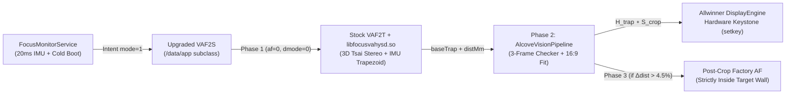

# WZATCO Yuva Blaze — Complete Reverse-Engineering & Manual Customization Guide

This document explains **everything we reverse-engineered, designed, built, and deployed** on your **WZATCO Yuva Blaze** projector, along with **complete copy-pasteable manual instructions** so you can reproduce, tweak, update, or roll back any part yourself at any time.

---

## 1. Hardware & Firmware Architecture

Through live ADB inspection, GPT block analysis, and DEX/ELF reverse engineering (`com.hysd.screen.apk`, `com.hysd.client.apk`, `Htp_Jetter.apk`, `Htp_ScreenSaver.apk`, `libfocusvahysd.so`, and `libbootanimation.so`), we mapped the projector's complete software stack:

| Subsystem | Hardware / Binary Details |
|---|---|
| **SoC & OS** | Allwinner H727 (`sun50iw15p1`), 4× ARM Cortex-A53 (`armeabi-v7a` 32-bit only), 1 GB RAM, Android 14 `userdebug` (`A series_0.0.1_2604240125`), SELinux `Permissive` |
| **Optical Panel** | BOE `1920×1080` native LCD (`castmode` + Allwinner DisplayEngine hardware keystone) |
| **Signing Key** | Standard AOSP `platform` testkey (`SHA-256: c8a2e9bccf597c2fb6dc66bee293fc13f2fc47ec77bc6b2b0d52c11f51192ab8`) |
| **Verified Boot (AVB)** | `vbmeta_a` hashes `boot`, `dtbo`, `init_boot`, `vendor_boot`, `product`, `system`, and `vendor`. **`bootloader_a`, `Reserve0_a`, and `/data` are outside AVB** — allowing 100% safe `/data/app` upgrades and boot-splash updates without touching `/system` or `/vendor`. |
| **Internal Camera** | USB UVC `640×480` YUYV422 camera at `/dev/video0` (`config.disable_cameraservice=true` disables Android Camera2; accessed directly via V4L2 JNI methods `HYSDVAF2.s0cam(0,2)`, `s1cam(byte[614400])`, `s2cam()` in `libfocusvahysd.so`). |
| **Factory Calibration** | Per-unit Tsai camera-projector stereo extrinsics & lookup tables stored in `/sdcard/focus/` (`camdata`, `hybin`, `hybin2`, `usefuldata`) and `/Reserve0/focus/`. |
| **Hardware Keystone** | `com.hysd.client.VAFclientapi` (`HYSDInterface.setkey(ltx, lty, lbx, lby, rbx, rby, rtx, rty)`) passes 8 inward pixel offsets to Allwinner `IDisplayConfig`: `TL=(ltx, lty)`, `BL=(lbx, 1080-lby)`, `BR=(1920-rbx, 1080-rby)`, `TR=(1920-rtx, lty)`. |
| **Repoint & Boot Monitor** | `com.htp.app.jetter.service.FocusMonitorService` polls the 3-axis IMU every `20 ms` (`DataDriftChecker`) and triggers `com.hysd.hyscreen/.VAF2S` (`mode=1, afswitch=1, keyswitch=1, dmode=3`) on bootup and whenever the projector settles after moving. |



---

## 2. Connecting to the Projector & Full Factory Backup

Your projector listens on wireless ADB port `5555` (`MAC: 3C-BE-8E-43-78-87`). When connected to your Windows PC's Mobile Hotspot (`192.168.137.x`), you can locate its IP and connect anytime:

```powershell
$adb = "$env:LOCALAPPDATA\Android\Sdk\platform-tools\adb.exe"

# Find the projector's IP on Windows Mobile Hotspot by MAC address
$ip = (Get-NetNeighbor -AddressFamily IPv4 |
    Where-Object { $_.LinkLayerAddress -match "3C-BE-8E-43-78-87" } |
    Select-Object -First 1).IPAddress

& $adb connect "${ip}:5555"
& $adb -s "${ip}:5555" devices
```

### How the Full Backup Was Performed (and How to Repeat It)
Because `/dev/block/mmcblk0` has `0666` (`rw-rw-rw-`) permissions on this firmware, you can dump any partition directly over ADB without rooting or opening the chassis:

```powershell
$backupDir = "C:\Users\ngantla\Backups\Wzatco-Yuva-Blaze"
New-Item -ItemType Directory -Force -Path "$backupDir\calibration","$backupDir\partitions" | Out-Null

# 1. Back up unit-unique factory optical calibration (CRITICAL — unique to your physical lens/camera!)
& $adb -s "${ip}:5555" pull /sdcard/focus "$backupDir\calibration\focus"
& $adb -s "${ip}:5555" pull /sdcard/focus_d "$backupDir\calibration\focus_d"

# 2. Dump a raw partition by GPT LBA range (example: bootloader_a at LBA 106496, 65536 sectors = 32 MiB)
& $adb -s "${ip}:5555" exec-out "dd if=/dev/block/mmcblk0 bs=512 skip=106496 count=65536 2>/dev/null" > "$backupDir\partitions\bootloader_a.img"

# 3. Verify SHA-256 on PC vs live projector eMMC
$pcHash  = (Get-FileHash "$backupDir\partitions\bootloader_a.img" -Algorithm SHA256).Hash.ToLower()
$devHash = (& $adb -s "${ip}:5555" shell "dd if=/dev/block/mmcblk0 bs=512 skip=106496 count=65536 2>/dev/null | sha256sum").Split(" ")[0]
Write-Host "PC=$pcHash  Device=$devHash  Match=$($pcHash -eq $devHash)"
```

---

## 3. Fast 3D Trapezoid + Sidewall/Obstacle Avoidance + Post-Crop Autofocus

### 3.1 What Was Wrong with Stock Alignment (and Our Early Prototypes)
1. **Stock `com.hysd.screen` (`dmode=3`)**: Took ~12–16 seconds, only looked for high-contrast dark obstacles inside an uncalibrated contour, completely missed recessed grey alcove side walls, and swept the focus motor *before* cropping (causing two-depth focus blur between near side walls and the far center wall).
2. **Android & Hardware Gotchas We Solved**:
   - **AVB Read-Only `/system`**: Modifying `/system/priv-app/com.hysd.screen` directly would break `vbmeta_system` dm-verity. Instead, because the ROM uses the public AOSP `platform` key, we sign an upgraded APK with higher/same signature and install it to `/data/app` (`adb install -r -d`).
   - **DEX Subclass Hook (`VAF2S` → `VAF2T`)**: In stock `classes.dex`, we renamed all 38 occurrences of `Lcom/hysd/hyscreen/VAF2S;` to `Lcom/hysd/hyscreen/VAF2T;` (exact same 25-byte length and lexicographic sort order, recomputing DEX SHA-1 + Adler32). Then we compiled our own `public class VAF2S extends VAF2T` into `classes3.dex`, giving us full control to intercept intents, override `workfinished()` and `delay(int)`, and delegate non-obstacle modes cleanly to `super`.
   - **Android 12+ Overlay Dimming**: Setting `WindowManager.LayoutParams.FLAG_NOT_TOUCHABLE` on `TYPE_APPLICATION_OVERLAY` causes Android 12+ InputDispatcher/SurfaceFlinger to force `alpha = 0.80`. Omitting `FLAG_NOT_TOUCHABLE` preserves 100% brightness.
   - **UVC Auto-Exposure & V4L2 Ring Buffers**: Switching between black (`0`) and white (`255`) frames caused massive UVC camera auto-exposure swings and 4-buffer V4L2 lag. Projecting **constant-50%-flux complementary `20×12` checkerboards** (`MODE_CHECKER_POS`, `MODE_CHECKER_NEG`, and `MODE_ORIGIN_TAG` with an asymmetric 3-tile L-triad at `(10,6)`) keeps total scene light constant (`0` AE drift) and lets us gate V4L2 frame capture closed-loop on **signed pixel correlation inversion**.
   - **3D Trapezoid + Crop Composition**: An axis-aligned crop alone looks skewed when the projector is tilted or yawed. By running Phase 1 (`dmode=0` Tsai stereo + IMU trapezoid `baseTrap`), projecting the checkerboard *inside* `baseTrap`, and mapping the clean `16:9` sub-rectangle $[s_0,s_1]\times[t_0,t_1]$ through `baseTrap`'s $3\times 3$ homography $\mathbf{H}_{\text{trap}}$, all 4 corners on the physical wall remain exact $90^\circ$ right angles.
   - **4.2× Speedup (`16.1 s` → `3.75 s` on repoints)**:
     - Replaced $O(N \cdot R)$ 2D max-filters with **van Herk $O(1)$-per-pixel prefix/suffix max-filters** and **pre-allocated static scratch buffers** (eliminating ~15 MB/scan of heap churn and ART GC pauses on 1 GB RAM; Stage 2 runs in **`785 ms`**).
     - Fixed a stock `HYSDkeystone$motorbegin` thread leak (`motorthreadstop(-3)`) that previously double-stepped the focus motor.
     - Added **smart stereo-depth AF gating**: Phase 1's Tsai triangulation outputs throw distance in millimeters (`result_angle[9]`). On cold boot or distance changes `> 4.5%`, Phase 3 runs factory autofocus *strictly inside* the final cropped `16:9` target wall; on in-place pan/tilt (`≤ 4.5%` distance change), it skips the redundant 5 s motor sweep.

### 3.2 How to Manually Build, Deploy, Tune, or Roll Back the Alignment Engine

All complete Java sources and platform signing keys are saved in:
- Source backup: `C:\Users\ngantla\Backups\Wzatco-Yuva-Blaze\custom_upgrades\src\`
- Pre-built signed APK: `C:\Users\ngantla\Backups\Wzatco-Yuva-Blaze\custom_upgrades\com.hysd.screen-turbo-alcove.apk`

#### Manual Re-Install (Pre-Built APK)
```powershell
$adb = "$env:LOCALAPPDATA\Android\Sdk\platform-tools\adb.exe"
$apk = "C:\Users\ngantla\Backups\Wzatco-Yuva-Blaze\custom_upgrades\com.hysd.screen-turbo-alcove.apk"

& $adb -s "${ip}:5555" install -r -d $apk
& $adb -s "${ip}:5555" shell "cmd package compile -m speed -f com.hysd.hyscreen"
```

#### Manual Rebuild from Java Source
If you edit `VAF2S.java`, `AlcoveVisionPipeline.java`, `PatternOverlayView.java`, or `HomographySolver.java`:

```powershell
$sdk     = "$env:LOCALAPPDATA\Android\Sdk"
$btDir   = (Get-ChildItem "$sdk\build-tools" | Sort-Object Name -Descending | Select-Object -First 1).FullName
$platJar = (Get-ChildItem "$sdk\platforms\*\android.jar" | Sort-Object FullName -Descending | Select-Object -First 1).FullName
$jbr     = "C:\Program Files\Android\Android Studio\jbr"
$env:JAVA_HOME = $jbr
$env:PATH      = "$jbr\bin;$env:PATH"

$proj     = "C:\Users\ngantla\Backups\Wzatco-Yuva-Blaze\custom_upgrades"
$stockApk = "C:\Users\ngantla\Backups\Wzatco-Yuva-Blaze\apks\system_priv_app\com.hysd.hyscreen\com.hysd.screen.apk"

# 1. Patch stock classes.dex (VAF2S -> VAF2T) using Node.js and recompute SHA-1 + Adler32
#    (or reuse patched classes.dex), then compile your Java sources to classes3.dex:
$srcs = Get-ChildItem "$proj\src" -Recurse -Filter *.java | ForEach-Object { $_.FullName }
& "$jbr\bin\javac.exe" --release 8 -cp "$proj\stubs.jar;$platJar" -d "$proj\build\classes" $srcs
& "$jbr\bin\jar.exe" cf "$proj\build\alcove_engine.jar" -C "$proj\build\classes" .
& "$btDir\d8.bat" --min-api 26 --lib $platJar --classpath "$proj\stubs.jar" --output "$proj\build\dex_out" "$proj\build\alcove_engine.jar"

# 2. Insert patched classes.dex (uncompressed) + classes3.dex into a copy of stockApk, zipalign, and sign:
& "$btDir\zipalign.exe" -p -f 4 "$proj\build\unsigned.apk" "$proj\build\aligned.apk"
& "$btDir\apksigner.bat" sign --key "$proj\keys\platform.pk8" --cert "$proj\keys\platform.x509.pem" --out "$proj\com.hysd.screen-turbo-alcove.apk" "$proj\build\aligned.apk"

# 3. Install & AOT-compile on projector:
& "$sdk\platform-tools\adb.exe" -s "${ip}:5555" install -r -d "$proj\com.hysd.screen-turbo-alcove.apk"
& "$sdk\platform-tools\adb.exe" -s "${ip}:5555" shell "cmd package compile -m speed -f com.hysd.hyscreen"
```

#### Live Runtime Tuning Properties (No Rebuild Needed)
```powershell
# Trigger a full alignment + focus run manually over ADB:
& $adb -s "${ip}:5555" shell "am startservice -n com.hysd.hyscreen/.VAF2S --ei mode 1 --ei afswitch 1 --ei keyswitch 1 --ei dmode 3 --ei force_af 1"

# Save a visual diagnostic image (/sdcard/alcove_debug.png) on the next run:
& $adb -s "${ip}:5555" shell "setprop persist.hysd.alcove.debug 1"

# Adjust minimum allowed 16:9 screen area ratio (default 0.24 = 24% of panel):
& $adb -s "${ip}:5555" shell "setprop persist.hysd.alcove.min_area 0.24"

# Toggle green confirmation border flash (1 = on, 0 = silent):
& $adb -s "${ip}:5555" shell "setprop persist.hysd.alcove.hud 1"

# Instant fallback to stock VAF2T without uninstalling (0 = turbo active, 1 = stock):
& $adb -s "${ip}:5555" shell "setprop persist.hysd.turbo_disable 0"

# Full uninstall rollback to untouched factory /system APK:
& $adb -s "${ip}:5555" uninstall com.hysd.hyscreen
```

---

## 4. Manually Changing the Boot Screen (Both Power-On & Android Stages)

Your projector displays two separate boot visuals back-to-back:
1. **Stage 1 — Power-On Hardware Splash (`bootloader_a` partition)**:
   - `bootloader_a` (`/dev/block/mmcblk0p2`, GPT start LBA `106,496`) is a standard **FAT16** filesystem (`Volumn`).
   - Inside it, `BOOTLOGO.BMP` occupies 3,038 contiguous clusters starting at partition byte offset `10,412,544` (`sector 20,337`, which is raw `mmcblk0` **LBA `126,833`**).
   - Format: **Exact `6,220,854`-byte uncompressed 24-bit bottom-up BGR BMP** (`54`-byte `BITMAPINFOHEADER` + `1920 × 1080 × 3` pixel bytes). Because `6,220,854 = 12,150 × 512 + 54`, the final sector (`LBA 138,983`) has `458` trailing bytes belonging to the rest of the cluster — always preserve those `458` bytes when writing via `dd`!
2. **Stage 2 — Android `bootanimation` (`/Reserve0/bootanimation.zip` or Boot Video)**:
   - `/system/lib/libbootanimation.so` checks **`/Reserve0/bootanimation.zip` first** before `/system/media/bootanimation.zip`.
   - Format: An **uncompressed (`STORE`-only)** ZIP containing `desc.txt` (`1920 1080 15\np 0 0 part0\n` with Unix `LF` line endings) and `part0/01.jpg` (or multi-frame `01.jpg`, `02.jpg`, ... for an animation!).
   - *Optional MP4 Boot Video*: You can also place a `1920×1080` `.mp4` video at `/data/local/bootanim/bootanimation.mp4` and run `setprop persist.sys.bootanim.video_enable 1`.

### Step-by-Step PowerShell Script to Set Any Photo as Your Seamless Boot Screen

```powershell
$ErrorActionPreference = "Stop"
Add-Type -AssemblyName System.Drawing
Add-Type -AssemblyName System.IO.Compression

$photoPath = "C:\Path\To\Your\Photo.jpg"
$cropTopY  = 850   # Vertical crop offset in source pixels for 16:9 framing (0 = top)
$outDir    = "$env:TEMP\projector_boot"
New-Item -ItemType Directory -Force -Path $outDir | Out-Null

# 1. Crop to exact 16:9 and resize to 1920x1080 24-bit RGB
$src   = [System.Drawing.Bitmap]::FromFile($photoPath)
$cropW = $src.Width
$cropH = [int][Math]::Round($cropW * 9.0 / 16.0)
if ($cropTopY + $cropH -gt $src.Height) { $cropTopY = [Math]::Max(0, $src.Height - $cropH) }

$dst = New-Object System.Drawing.Bitmap(1920, 1080, [System.Drawing.Imaging.PixelFormat]::Format24bppRgb)
$g   = [System.Drawing.Graphics]::FromImage($dst)
$g.InterpolationMode = [System.Drawing.Drawing2D.InterpolationMode]::HighQualityBicubic
$g.DrawImage($src, (New-Object System.Drawing.Rectangle(0,0,1920,1080)),
             (New-Object System.Drawing.Rectangle(0,$cropTopY,$cropW,$cropH)), [System.Drawing.GraphicsUnit]::Pixel)
$g.Dispose(); $src.Dispose()

# 2. Save 1920x1080 JPEG and pack STORE-only bootanimation.zip
$jpgCodec  = [System.Drawing.Imaging.ImageCodecInfo]::GetImageEncoders() | Where-Object { $_.MimeType -eq "image/jpeg" }
$encParams = New-Object System.Drawing.Imaging.EncoderParameters(1)
$encParams.Param[0] = New-Object System.Drawing.Imaging.EncoderParameter([System.Drawing.Imaging.Encoder]::Quality, 95L)
$dst.Save("$outDir\01.jpg", $jpgCodec, $encParams)

Remove-Item "$outDir\bootanimation.zip" -Force -ErrorAction SilentlyContinue
$fs = [System.IO.File]::Open("$outDir\bootanimation.zip", [System.IO.FileMode]::Create)
$za = New-Object System.IO.Compression.ZipArchive($fs, [System.IO.Compression.ZipArchiveMode]::Create)
$dEntry = $za.CreateEntry("desc.txt", [System.IO.Compression.CompressionLevel]::NoCompression)
$ds = $dEntry.Open(); $db = [System.Text.Encoding]::ASCII.GetBytes("1920 1080 15`np 0 0 part0`n"); $ds.Write($db, 0, $db.Length); $ds.Close()
$iEntry = $za.CreateEntry("part0/01.jpg", [System.IO.Compression.CompressionLevel]::NoCompression)
$is = $iEntry.Open(); $ib = [System.IO.File]::ReadAllBytes("$outDir\01.jpg"); $is.Write($ib, 0, $ib.Length); $is.Close()
$za.Dispose(); $fs.Close()

# 3. Build exact 6,220,854-byte uncompressed 24-bit bottom-up BOOTLOGO.BMP
$bmpBytes = New-Object byte[] 6220854
$hdrHex   = "424d36ec5e000000000036000000280000008007000038040000010018000000000000ec5e00c40e0000c40e00000000000000000000"
for ($i = 0; $i -lt 54; $i++) { $bmpBytes[$i] = [Convert]::ToByte($hdrHex.Substring($i*2, 2), 16) }

$lock = $dst.LockBits((New-Object System.Drawing.Rectangle(0,0,1920,1080)),
                      [System.Drawing.Imaging.ImageLockMode]::ReadOnly,
                      [System.Drawing.Imaging.PixelFormat]::Format24bppRgb)
$row = New-Object byte[] 5760
for ($y = 0; $y -lt 1080; $y++) {
    [System.Runtime.InteropServices.Marshal]::Copy([IntPtr]::Add($lock.Scan0, (1079 - $y) * $lock.Stride), $row, 0, 5760)
    [Array]::Copy($row, 0, $bmpBytes, 54 + $y * 5760, 5760)
}
$dst.UnlockBits($lock); $dst.Dispose()
[System.IO.File]::WriteAllBytes("$outDir\custom_bootlogo.bmp", $bmpBytes)

# 4. Push to projector, splice preserving 458 trailing bytes of LBA 138983, write, and SHA-256 verify!
$adb = "$env:LOCALAPPDATA\Android\Sdk\platform-tools\adb.exe"
$bmpSha = (Get-FileHash "$outDir\custom_bootlogo.bmp" -Algorithm SHA256).Hash.ToLower()

& $adb -s "${ip}:5555" push "$outDir\bootanimation.zip" "/data/local/tmp/bootanimation.zip"
& $adb -s "${ip}:5555" push "$outDir\custom_bootlogo.bmp" "/data/local/tmp/custom_bootlogo.bmp"

# Note: Use shell redirection (`cat > /Reserve0/...`) rather than `adb push` directly to `/Reserve0`
# because `/Reserve0` is FAT16 and rejects `adb push`'s `fchown` syscall.
& $adb -s "${ip}:5555" shell '
cat /data/local/tmp/bootanimation.zip > /Reserve0/bootanimation.zip &&
dd if=/dev/block/mmcblk0 of=/data/local/tmp/bl_tail.bin bs=512 skip=138983 count=1 2>/dev/null &&
cat /data/local/tmp/custom_bootlogo.bmp > /data/local/tmp/custom_bootlogo_padded.bmp &&
dd if=/data/local/tmp/bl_tail.bin bs=1 skip=54 count=458 2>/dev/null >> /data/local/tmp/custom_bootlogo_padded.bmp &&
dd if=/data/local/tmp/custom_bootlogo_padded.bmp of=/dev/block/mmcblk0 bs=512 seek=126833 count=12151 conv=notrunc,fsync &&
sync &&
rm -f /data/local/tmp/bootanimation.zip /data/local/tmp/custom_bootlogo*.bmp /data/local/tmp/bl_tail.bin
'

$verifySha = (& $adb -s "${ip}:5555" shell "dd if=/dev/block/mmcblk0 bs=512 skip=126833 count=12151 2>/dev/null | head -c 6220854 | sha256sum").Split(" ")[0]
if ($verifySha -ne $bmpSha) { throw "SHA-256 mismatch!" }
Write-Host "Boot splash + Android bootanimation verified ($verifySha)!"
```

#### Restoring the Stock WZATCO Boot Screen Anytime
```powershell
& $adb -s "${ip}:5555" shell "rm -f /Reserve0/bootanimation.zip && sync"
& $adb -s "${ip}:5555" push "C:\Users\ngantla\Backups\Wzatco-Yuva-Blaze\partitions\bootloader_a.img" "/data/local/tmp/bootloader_a.img"
& $adb -s "${ip}:5555" shell "dd if=/data/local/tmp/bootloader_a.img of=/dev/block/mmcblk0 bs=512 seek=106496 count=65536 conv=notrunc,fsync && sync && rm -f /data/local/tmp/bootloader_a.img"
```

---

## 5. Manually Updating or Customizing the Photo Screensaver

### 5.1 How the Custom Screensaver Works
- Stock `Htp_ScreenSaver.apk` (`com.htp.app.screensaver`) is marked `android:persistent="true"` (so Android blocks `/data/app` replacements) and hardcodes 4 WebP files on the AVB-verified read-only `/vendor` partition (`vendor/etc/screen/paper_0..3.webp`).
- However, `Htp_ScreenSaver` already handles idle countdowns (`persist.sys.htp.screensaver`, default `5` minutes), video/HDMI playback detection (`hasKeepScreenOn()`), and sets `sys.lmk_top_app = "com.htp.app.screensaver"` the moment its wallpaper activity opens — and exposes `UsbNotifyBroadCastReceiver`, which cleanly calls `ScreenSaverActivity.finish()` upon receiving `MEDIA_MOUNTED`.
- We built **`PersonalScreenSaver.apk`** (`com.ngantla.personalscreensaver`, signed with the AOSP `platform` key as `android.uid.system`):
  1. Auto-starts `HtpSaverWatcherService` on `LOCKED_BOOT_COMPLETED` / `BOOT_COMPLETED` and also registers `PhotoDreamService` as Android's official `DreamService`.
  2. When HTP's idle screensaver triggers (`sys.lmk_top_app == "com.htp.app.screensaver"` in `"default"` wallpaper mode), it seamlessly opens `PersonalSlideshowActivity` on top and sends an explicit `MEDIA_MOUNTED` broadcast to `UsbNotifyBroadCastReceiver` so stock `ScreenSaverActivity` closes itself behind the scenes.
  3. Crossfades (`900 ms` fade) every `15 seconds` across all `.jpg`/`.jpeg`/`.png`/`.webp` photos in **`/sdcard/Screensaver`** (falling back to **`/Reserve0/screensaver`** before `/sdcard` unlocks), and returns directly to your Home screen / app on **1 single remote button press**.

### 5.2 Swapping or Adding New Screensaver Photos Manually (No Coding Required!)
You can put **any number of `1920×1080` photos** (`1`, `4`, `20`, etc.) into `/sdcard/Screensaver` (and `/Reserve0/screensaver`). They are sorted alphabetically (`01_...`, `02_...`, etc.):

```powershell
$adb = "$env:LOCALAPPDATA\Android\Sdk\platform-tools\adb.exe"

# Clear old photos and push your new 1920x1080 JPEGs/PNGs:
& $adb -s "${ip}:5555" shell "rm -f /sdcard/Screensaver/* /Reserve0/screensaver/*"

foreach ($img in Get-ChildItem "C:\Path\To\Framed1080pPhotos\*.jpg" | Sort-Object Name) {
    $name = $img.Name
    & $adb -s "${ip}:5555" push $img.FullName "/data/local/tmp/$name"
    & $adb -s "${ip}:5555" shell "cat /data/local/tmp/$name > /sdcard/Screensaver/$name && cat /data/local/tmp/$name > /Reserve0/screensaver/$name && rm -f /data/local/tmp/$name"
}
& $adb -s "${ip}:5555" shell "sync"

# Preview the slideshow immediately on your wall:
& $adb -s "${ip}:5555" shell "am start -n com.ngantla.personalscreensaver/.PersonalSlideshowActivity"
```

*Tip*: You can also copy photos onto a USB flash drive and copy them into `Internal Storage -> Screensaver` right from the projector's built-in File Manager!

#### Changing Screensaver Idle Timeout or Rolling Back to Stock
```powershell
# Change idle timeout (in minutes, e.g. 5, 10, 15, 30):
& $adb -s "${ip}:5555" shell "setprop persist.sys.htp.screensaver 5"

# Revert to stock HTP screensaver anytime:
& $adb -s "${ip}:5555" uninstall com.ngantla.personalscreensaver
```

---

## 6. Reference: Where Everything Is Stored on Your PC

All backups, keys, sources, and signed packages are archived under **`C:\Users\ngantla\Backups\Wzatco-Yuva-Blaze\`**:

- `BACKUP_README.md` & `SHA256SUMS.txt` — Master manifest & verified SHA-256 checksums of all 170 factory backup files (`4.48 GiB`).
- `calibration\focus\` & `calibration\focus_d\` — Your projector's irreplaceable factory Tsai camera/projector calibration files.
- `partitions\*.img` — Raw eMMC partition images (`bootloader_a/b.img`, `boot_a/b.img`, `Reserve0_a/b.img`, `factorydata.img`, `vbmeta*.img`, `super.img`).
- `apks\*` — All 119 stock APKs/APEXes pulled from `/system`, `/product`, `/vendor`, and `/data`.
- `custom_upgrades\com.hysd.screen-turbo-alcove.apk` & `custom_upgrades\src\*` — Signed 3-phase 3D trapezoid + alcove sidewall/obstacle avoidance + post-crop AF upgrade and Java source.
- `custom_upgrades\PersonalScreenSaver.apk` — Signed personal crossfading slideshow screensaver APK.
- `custom_upgrades\custom_bootlogo.bmp` & `custom_upgrades\bootanimation-personal.zip` — Framed `1920×1080` boot splash and Android boot animation archives.
- `MANUAL_UPGRADE_GUIDE.md` — Permanent local copy of this guide.
